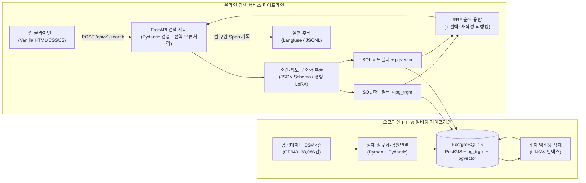

# 활력통 (`vitality-hub`) 서비스 기획서

> **시민 일상 회복 및 생활체육·모임·자연휴양 통합 정보 검색 시스템**

---

## 1. 서비스 개요 및 추진 배경

### 1.1 추진 배경

전국 단위의 도시공원, 실외운동기구, 공공개방시설, 자연휴양림 정보는 공공데이터포털에 표준 데이터셋 형태로 공개되어 있으나, 실제 시민이 일상에 활용하기에는 네 가지 구조적 장벽이 존재한다.

1. **데이터 분산**: 운동 공간(도시공원·실외운동기구), 모임 공간(공공개방시설), 휴양·숙박 공간(자연휴양림)이 서로 다른 스키마와 기관 단위로 분리되어 교차 탐색이 어렵다.
2. **자연어 요구와 정형 검색의 괴리**: 시민은 “주말 오후에 10명 무료로 모일 곳”, “가볍게 운동할 공원”처럼 의도와 조건이 섞인 자연어로 탐색하지만 기존 목록형 검색은 정확한 시설명 일치에만 의존한다.
3. **데이터 결측·비정형으로 인한 오안내 위험**: 유료 표기(`Y`)이지만 사용료가 비어 있는 시설을 무료로 오표기하거나, 위경도가 누락된 시설의 거리를 잘못 산출하는 등 공공데이터 원본 결함이 그대로 노출된다.
4. **오류와 ‘결과 없음’의 혼재**: 시스템·DB 조회 장애 발생 시 빈 목록으로 처리되어 시민이 실제로 존재하는 시설을 “없음”으로 오인하는 신뢰 저하가 발생한다.

### 1.2 서비스 정의 및 핵심 가치

**활력통(`vitality-hub`)**은 4종의 전국 공공 표준 데이터(총 **38,086건**)를 단일 통합 스키마로 정제·적재하고, **결정론적 SQL/공간 조건 판정**과 **키워드·벡터 하이브리드 검색**을 결합해 시민에게 근거 기반의 공간 정보를 제공하는 통합 검색 정보 서비스다.

| 핵심 가치 | 구현 원칙 |
| --- | --- |
| **정확성 (Deterministic Facts)** | 지역, 무료 여부, 수용인원, 평일/주말 운영시간, 숙박 가능 여부, 거리 계산은 AI 추측이 아닌 SQL/PostGIS로 100% 결정론적 판정 |
| **투명성 (Honest Uncertainty)** | `유료(Y)+요금 공란 → 요금 미확인`, `좌표 누락 → 거리 미산출`, 원본 제공기관·기준일자·시설 ID를 모든 응답에 필수 병기 |
| **신뢰성 (Resilient UX & Ops)** | `정상 결과(200 OK)`, `조건 일치 없음(200 EMPTY)`, `입력 오류(422)`, `DB 장애(503)`, `모델 지연 초과(504)`를 엄격히 분리하고 장애 복구 가능한 컨테이너·클러스터 기반 운영 |

---

## 2. 데이터 자산 분석 및 정제 정책

### 2.1 대상 공공데이터 4종 전수 진단

| 데이터셋 | 레코드 수 | 원본 인코딩 | 핵심 활용 속성 | 확인된 원본 데이터 결함 |
| --- | ---: | --- | --- | --- |
| `전국도시공원정보표준데이터.csv` | 18,376 | CP949 | 공원명, 공원구분, 면적, 5개 보유시설 컬럼, 주소, 위경도 | `테니스장+배드민턴장 등` 비정형 구분자 나열 |
| `전국실외운동기구설치정보표준데이터.csv` | 12,191 | CP949 | 설치장소명, 시도/시군구, 운동기구명, 수량, 주소, 위경도 | **좌표 누락 4,238건(34.8%)**, `트위스트+트위스트+에어워킹` 중복 나열, 공원 외래키 부재 |
| `전국공공시설개방정보표준데이터.csv` | 7,333 | CP949 | 개방시설명, 유형, 평일/주말 운영시각, 유무료, 사용료, 수용인원 | **유료(`Y`)이나 사용료 공란/0인 행 1,115건(15.2%)** |
| `전국휴양림표준데이터.csv` | 186 | CP949 | 휴양림명, 구분, 수용인원, 입장료, 숙박가능여부, 주요시설명 | 입장료 필드 비정형 혼재(`일반1000원+단체800원`, `무료`, `'N'`) |
| **합계** | **38,086** | **CP949** | **위치 · 유형 · 조건 · 보유시설 공통 축 통합** | **전처리 불변 규칙 및 자동 회귀 테스트 필수** |

### 2.2 데이터 정제·정규화 불변 규칙

1. **인코딩 표준화**: CP949(EUC-KR 확장) 우선 디코딩, UTF-8-SIG 폴백 지원.
2. **요금 3상태 모델 (`FREE` / `PAID` / `UNKNOWN`)**:
   - `유료사용여부 = N` 또는 휴양림 입장료 `'무료'`, `'N'` → `FREE (0원)`
   - `유료사용여부 = Y` 및 양수 금액 확인 → `PAID (금액)`
   - `유료사용여부 = Y`이나 사용료 공란/0/파싱 불가 → **`UNKNOWN` (`요금 미확인 · 기관 문의 필요`)** — 무료 필터(`free_only=true`) 결과에서 원천 배제.
3. **좌표 검증 및 거리 미산출 규칙**:
   - 대한민국 유효 경위도 범위(`위도 33.0~38.9`, `경도 124.5~132.0`) 이탈 또는 공란 행은 `geom = NULL` 저장.
   - 거리 조회 시 `distance_m = null` 반환, 화면 표기 `"거리 미산출"`, 거리순 정렬 시 `NULLS LAST` 적용.
4. **비정형 시설·기구 토큰 정규화**: `+`, `,`, `/` 구분자 분리, 말미 `' 등'` 제거, 순서 유지 중복 제거 배열(`amenities TEXT[]`) 저장.
5. **도시공원 ↔ 실외운동기구 보수적 연결 (`park_linker`)**:
   - 괄호·위치 접미어(`야외운동기구`, `앞/뒤/내`) 제거 후 `(시도, 시군구, 정규화명)` 복합 키 매칭.
   - 양측 좌표 존재 시 반경 500m 이내 최근접 공원만 연결, 좌표 누락 시 해당 시군구 내 **유일 일치 공원 1건**인 경우에만 좌표 보강(동명이공원 오매칭 차단).
6. **멱등 적재(Idempotent Upsert)**: 관리번호 또는 결정론적 SHA-1 키 기반 `ON CONFLICT (id) DO UPDATE` 처리로 주기적 갱신 CSV 재적재 시 중복 행 0건 보장.

---

## 3. 핵심 사용자 시나리오 및 기능 명세

### 3.1 3대 사용자 의도와 데이터 매핑

| 의도 코드 | 시민 탐색 니즈 | 주 연결 데이터 | 대표 질의 예시 |
| --- | --- | --- | --- |
| `EXERCISE` | 운동할 곳 | 도시공원 + 실외운동기구 + 체육 개방시설 | “서울 용산구 가볍게 배드민턴 칠 공원”, “대전 동구 트위스트 운동기구” |
| `MEETING` | 모일 곳 | 공공개방시설(회의실·강당·다목적실) | “이천시 주말 오후 50명 이상 무료 회의실” |
| `LODGING` | 숙박·휴양할 곳 | 자연휴양림 | “경남 가족 숙박과 목공예 체험 가능한 휴양림” |

### 3.2 핵심 기능 요구사항

1. **통합 자연어·조건 복합 검색**
   - 입력: 자연어 질의문 + 선택 필터(지역, 의도, 무료만, 숙박 가능, 최소 수용인원, 희망 이용 시각, 평일/주말, 검색 모드).
   - 자연어 내 구어체 조건(“열 명”, “오후 두 시”)을 구조화 규격(JSON Schema)으로 해석 후 Pydantic 이중 검증.
   - 사용자가 화면에서 직접 선택한 필터를 AI 추출값보다 우선 적용.
2. **키워드·벡터·하이브리드 검색 모드 지원**
   - **키워드 기준선(`keyword`)**: `pg_trgm` 유사도·부분일치 기반 정확한 시설명 탐색.
   - **의미 검색(`vector`)**: `pgvector` 코사인 거리 기반 활동·시설 설명 의미 매칭.
   - **하이브리드(`hybrid`, 기본 권장)**: 키워드 Top-20과 벡터 Top-20을 비동기 병렬 조회 후 RRF(`1/(60+rank)`)로 순위 융합.
3. **근거·불확실성 중심 결과 카드 UI (Vanilla HTML/CSS/JS)**
   - 시설명, 주소, 거리(또는 `거리 미산출`), 요금 배지(무료 / 확정금액 / `요금 미확인` 경고 배지), 수용인원, 숙박 가능 여부, 보유시설 칩, 출처 기관명·데이터 기준일자·시설 ID 일괄 표시.
4. **상태·오류 분리 UX**
   - `200 OK`: 결과 목록 + 좌표 누락 항목 포함 시 안내 배너 표시.
   - `200 EMPTY`: “조건 일치 시설 없음” + 조건 완화 유도(장애와 완전 분리).
   - `422 INVALID_INPUT`: 입력값 형식 교정 안내(`retryable: false`).
   - `503 DB_UNAVAILABLE` / `504 MODEL_TIMEOUT`: “정보 확인 실패” 명시 + 재시도 버튼 제공(`retryable: true`) 또는 키워드 기준선 폴백 안내.

---

## 4. 시스템 아키텍처 및 기술 스택

### 4.1 전체 데이터·요청 흐름

### 4.2 영역별 기술 스택 및 채택 근거

| 영역 | 채택 기술 | 적용 역할 및 선정 근거 | 채택 구분 |
| --- | --- | --- | --- |
| **프론트엔드** | `HTML5`, `CSS3`, `Vanilla JS` | 별도 번들러 없이 FastAPI 정적 서빙 연동, 디자인 토큰 기반 경량 UI 및 HTTP 상태별 오류·빈상태 명확 제어 | **확정** |
| **API·검증** | `FastAPI`, `Pydantic`, `JSON Schema`, `httpx(asyncio)` | Pydantic 단일 모델에서 API 검증과 AI Structured Output 스키마 동시 생성, 외부 I/O 비동기 병렬 처리, 전역 오류 코드 통일 | **확정** |
| **데이터·검색 저장소** | `PostgreSQL 16`, `PostGIS`, `pg_trgm`, `pgvector` | 3.8만 건 규모에서 SQL 필터·공간 거리·한국어 부분검색·벡터 검색을 단일 트랜잭션 엔진으로 통합해 동기화 복잡도 제거 | **확정** |
| **검색 고도화** | `RRF 하이브리드`, `검색어 재작성`, `Cross-Encoder 리랭킹` | 키워드·벡터 간 스케일 왜곡 없는 RRF 결합. 재작성(하드 조건 불변식 잠금)과 리랭킹(Top-K 제한)은 실패 패턴 관측 시 선별 적용 | **하이브리드 확정 / 고도화 선택** |
| **평가·관측성** | `고정 평가셋`, `pytest`, `Langfuse` *(LangSmith 택1)*, `RAGAS` | 정량 필드·적중률은 결정론적 테스트로 고정, 호출 경로·지연·토큰은 Langfuse 추적, 자유 서술 추천 사유는 RAGAS 충실도 평가 | **평가셋·추적 확정 / RAGAS 선택** |
| **경량 모델 실험** | `PyTorch`, `HF Transformers`, `PEFT`, `LoRA` | 고정 도메인 의도 분류(3종) 및 시간·인원 슬롯 추출의 지연·비용 절감을 위해 소형 모델 LoRA 실험 후 API 방식과 정량 비교 *(vLLM은 고트래픽 자체 서빙 단계로 보류)* | **선택 실험** |
| **인프라·CI/CD** | `Linux`, `Docker`, `Docker Compose`, `Git`, `GitHub Actions`, `Kubernetes` | `Dockerfile.db`(PostGIS+pgvector 통합) 기반 로컬 원클릭 재현, PR 자동 `pytest` CI, K8s `Deployment(replicas 2)+Probe+HPA` 및 `StatefulSet(PVC)` 기반 무중단 운영 | **확정 (CD·모니터링 선택)** |

---

## 5. 통합 데이터 모델 및 API 계약 요약

### 5.1 통합 테이블 (`places`) 핵심 설계

- **식별·분류**: `id (PK)`, `source_type ('PARK'|'EQUIPMENT'|'PUBLIC_OPEN'|'FOREST')`, `intent_tags TEXT[]`, `name`, `category`
- **지역·공간**: `sido`, `sigungu`, `road_address`, `jibun_address`, `geom GEOGRAPHY(Point, 4326)` *(누락 시 NULL)*, `linked_park_id (FK)`
- **조건 판정**: `fee_status ('FREE'|'PAID'|'UNKNOWN')`, `fee_amount`, `fee_raw_text`, `capacity`, `weekday_open/close`, `weekend_open/close`, `lodging_avail`
- **검색·보존**: `amenities TEXT[]`, `search_text` (`pg_trgm` GIN), `embedding VECTOR(1536)` (`HNSW`), `provider_name`, `data_ref_date`, `raw_payload JSONB`

### 5.2 핵심 API 엔드포인트 계약

| 엔드포인트 | 메서드 | 역할 | 주요 상태 코드 |
| --- | --- | --- | --- |
| `/api/v1/search` | `POST` | 조건·키워드·벡터·하이브리드 통합 시설 검색 | `200 OK/EMPTY`, `422 INVALID_INPUT`, `503 DB_UNAVAILABLE`, `504 MODEL_TIMEOUT` |
| `/healthz` | `GET` | 서버 생존 및 PostgreSQL 연결(`SELECT 1`) 상태 점검 (K8s Readiness/Liveness Probe 연동) | `200 OK`, `503 Degraded` |
| `/` | `GET` | Vanilla HTML/CSS/JS 통합 검색 웹 화면 정적 서빙 | `200 OK` |

---

## 6. 품질 보증(QA) 및 정량 평가 전략

1. **전처리·도메인 불변식 단위 테스트 (`pytest` + GitHub Actions CI)**
   - PR마다 `유료Y+공란 → UNKNOWN`, `좌표누락/이상치(0,0) → NULL`, `+` 중복 토큰 제거, 휴양림 `'N'` 무료 정규화, 공원-운동기구 동명이공원 차단 규칙을 자동 검증.
2. **고정 평가 질문 세트 (`eval/eval_cases.jsonl` + `eval/run_eval.py`)**
   - 5대 유형(정확 시설명, 의미·구어체 질의, 복합 조건, 요금 공란·좌표 누락 경계, 후보 없음 `EMPTY`)을 고정 문제집으로 관리.
   - 모든 검색·모델 변경 시 동일 평가셋에서 **Hit@3, MRR, 하드 조건 위반율(목표 0%), p95 응답 지연(ms)** 4대 지표를 기록.
3. **실행 추적 및 환각 이중 검증**
   - `VitalityTracer`(Langfuse 연동 / 오프라인 JSONL 폴백)로 `조건 추출 → SQL/벡터 후보 → RRF 결합` 스팬별 입력·후보·지연을 기록해 검색 오류와 생성 오류를 분리 진단.
   - 자유 서술 추천 문구 적용 시 정량 필드(요금·거리·ID)는 결정론적 검증 함수로, 서술 근거 충실도는 `RAGAS Faithfulness`로 이중 검증.
4. **프롬프트 vs LoRA 경량 모델 공정 비교 기준**
   - 동일 검증셋에서 `의도 분류 정확도`, `시간·인원 슬롯 F1`, `JSON Schema 유효율`, `평균 추론 지연(ms)`을 비교해, 고빈도 정형 질의는 경량 모델로 처리하고 저신뢰도 복합 질의만 대형 API로 라우팅하는 하이브리드 운영 근거 확보.

---

## 7. 단계별 구축 마일스톤 (Phase 0 ~ Phase 7)

### Core 구축 트랙 (필수 서비스 완성)

| Phase | 단계 목표 | 핵심 산출물 | 완료 기준 (DoD) |
| --- | --- | --- | --- |
| **Phase 0** | 실행 환경·컨테이너·CI 기반 | `docker/postgres/Dockerfile.db`, `init.sql`, `docker-compose.yml`, `Dockerfile`, `pyproject.toml`, `ci.yml` | `docker compose up --build` 후 `postgis`, `pg_trgm`, `vector` 3종 확장 활성 및 CI `pytest` 통과 |
| **Phase 1** | 4종 공공데이터 ETL·스키마·테스트 | `schema.sql`, `normalizers.py`, `park_linker.py`, `load_csv.py`, `test_normalizers.py` | 38,086건 멱등 Upsert 완료, `UNKNOWN` 1,115건+ 및 `geom IS NULL` 4,238건 정합 검증, 재실행 시 중복 0건 |
| **Phase 2** | 결정론적 검색 기준선 API | `schemas/search.py`, `place_repo.py`, `routes_search.py`, `errors.py`, `main.py` | `keyword` 모드 정확 명칭 1위 반환, `422/200 EMPTY/503` 오류 분리 동작 검증 |
| **Phase 3** | 고정 평가셋 & 자동 채점 하네스 | `eval/eval_cases.jsonl`, `eval/run_eval.py` | 키워드 기준선 Hit@3·MRR·p95 기준 성적표 확보 및 의미 질의 실패 사례 정량 식별 |
| **Phase 4** | 하이브리드 RAG & 실행 추적 | `query_extractor.py`, `embeddings.py`, `hybrid_search.py`, `tracing.py` | 임베딩 HNSW 인덱스 구축, `keyword` 대비 `hybrid(RRF)` Hit@3 상승 확인, 전 구간 트레이스 기록 |
| **Phase 7** | 웹 UI 통합 & Kubernetes 배포 | `web/(index.html, styles.css, app.js)`, `k8s/(configmap-secret, postgres, deployment, service, hpa).yaml` | 브라우저 검색 UI 연동, K8s `2/2 Running`, Pod 삭제 시 무중단 자동 복구 및 HPA 부하 확장 확인 |

### 심화 고도화 트랙 (관측 근거 기반 선택 적용)

| Phase | 단계 목표 | 핵심 산출물 | 완료 기준 (DoD) |
| --- | --- | --- | --- |
| **Phase 5** | 실패 패턴 기반 검색 고도화 | `query_rewriter.py`, `reranker.py`, `eval/run_ragas.py` | 재작성 전후 하드 조건 100% 보존, 리랭킹 MRR 개선폭 대비 지연 트레이드오프 측정, 정량 환각 0건 |
| **Phase 6** | 소형 모델 LoRA 파인튜닝 비교 | `ml/build_dataset.py`, `ml/train_lora.py`, `ml/evaluate_compare.py` | 평가셋 오염 0건 분리, LoRA 어댑터 학습 완료, API 프롬프트 대비 정확도·지연·유효율 비교 리포트 산출 |

---

## 8. 리스크 관리 및 중장기 확장 계획

| 리스크 | 발생 원인 | 현재 대응 전략 | 중장기 확장 경로 |
| --- | --- | --- | --- |
| **한국어 부분검색 정밀도 저하** | PostgreSQL 기본 `tsvector` 한국어 형태소 미지원 | `pg_trgm` GIN 색인 + 도메인 동의어 사전 + `pgvector` RRF 보완 | 데이터 수백만 건 확장 시 Repository 인터페이스 교체로 OpenSearch/Nori 분리 |
| **실외운동기구 좌표 누락(34.8%)** | 원본 공공데이터 위경도 공란 | `geom=NULL(거리 미산출)` 계약 고정 + 유일 일치 공원 1차 보강 | 도로명·지번 주소 기반 배치 지오코딩 파이프라인 2차 보강 |
| **외부 LLM API 지연·장애** | 네트워크·모델 서버 응답 지연 | `httpx` 타임아웃 제어(`504` 분리) + 키워드 기준선 즉시 폴백 | 고빈도 의도·슬롯 추출은 경량 LoRA 로컬 추론 전환, 고트래픽 시 `vLLM` 도입 검토 |
| **컨테이너·DB 상태 유실** | Pod 재시작 시 디스크 초기화 | API는 Stateless `Deployment`, DB는 `StatefulSet + PVC` 분리 | 운영 환경 전환 시 관리형 PostgreSQL(RDS/Cloud SQL) 및 자동 백업·CD/모니터링 연동 |
